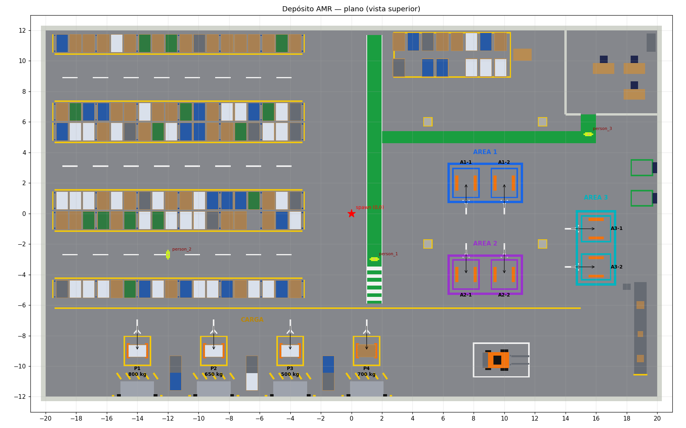
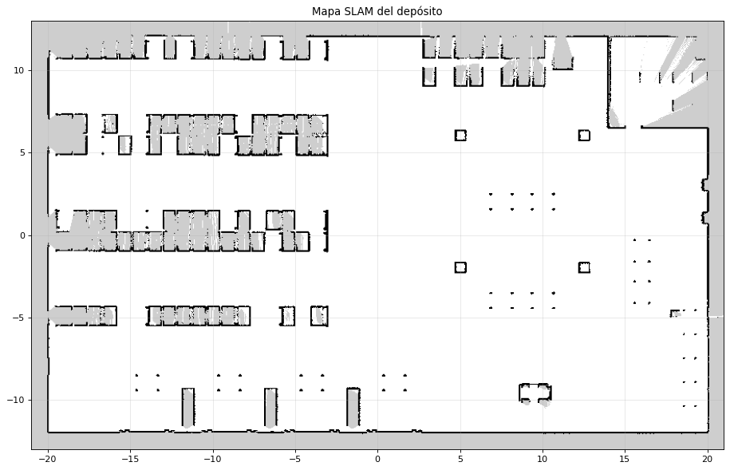

# AMR de elevación de palets — workspace ROS 2 Jazzy

Robot móvil autónomo para depósitos industriales: transporte de palets EUR
de hasta **1000 kg**, tracción **omnidireccional mecanum**, plataforma
elevadora de **1,0 m** de carrera.

## Paquetes

| Paquete | Contenido |
|---|---|
| `amr_description` | Modelo URDF/Xacro modular, configuración de RViz, launch de visualización |
| `amr_gazebo` | Mundo de depósito (generado), `ros2_control`, puente ROS-GZ, scripts de elevación |
| `amr_navigation` | EKF (encoders + IMU), fusión de LiDAR a 360°, SLAM (`slam_toolbox`), mapa, AMCL + Nav2 (MPPI omnidireccional) |
| `amr_tasks` | Gestor de tareas: viajes área de carga → áreas designadas, atraque bajo estaciones, elevación |

```
amr_description/urdf/
├── amr.urdf.xacro              # ensamblado principal (args: use_sim, controllers_file)
└── components/
    ├── properties.xacro        # TODAS las cotas, masas y parámetros de sensores
    ├── materials_inertia.xacro
    ├── chassis.xacro           # cuerpo 1200x800 con muescas para LiDAR
    ├── mecanum_wheel.xacro     # rueda Ø200 + fricción anisótropa para Gazebo
    ├── lift.xacro              # lift_joint + mástil telescópico visual (4 etapas)
    ├── sensors.xacro           # 2 x LiDAR 270°, IMU
    └── ros2_control.xacro      # gz_ros2_control / mock_components
```

## Especificaciones del modelo

| | |
|---|---|
| Huella | 1200 × 800 mm (palet EUR) |
| Altura plegado | 0,408 m (cara superior de la plataforma) |
| Elevación | 0 – 1,0 m (`lift_joint`), velocidad nominal 0,05 m/s |
| Masa | ≈ 570 kg en vacío · carga útil 1000 kg |
| Ruedas | 4 × mecanum Ø200 mm, batalla 0,90 m, vía 0,60 m, máx. 15 rad/s (1,5 m/s) |
| LiDAR | 2 × 2D 270°, 0,25°, 0,1–25 m, 15 Hz — esquinas delantera-izquierda y trasera-derecha |
| IMU | centro del AMR (`imu_link`, z = 0,20 m), 100 Hz |
| Encoders | posición/velocidad de cada rueda en `/joint_states` |

### Frames
```
map ─(AMCL / slam_toolbox)→ odom ─(EKF)→ base_footprint → base_link ─┬─ {front,rear}_{left,right}_wheel_link
                                   ├─ lidar_front_link / lidar_rear_link
                                   ├─ imu_link
                                   ├─ lift_platform_link → load_surface_link
                                   └─ lift_stage1..4_link  (visual)
```

## Uso

```bash
mkdir ~/amr_ws
git clone https://github.com/chebazz/Autonomous-Warehouse-Robot.git ~/amr_ws
cd ~/amr_ws
colcon build --symlink-install
source install/setup.bash

# Solo modelo en RViz (con sliders para ruedas y elevador)
ros2 launch amr_description display.launch.py

# Simulación en Gazebo + RViz (depósito detallado por defecto)
ros2 launch amr_gazebo sim.launch.py
#   opciones: headless:=true rviz:=false x:= y:= yaw:= world:=<ruta.sdf>
#   frente a la estación 1 (palet de 800 kg):  x:=-14.0 y:=-6.6 yaw:=-1.5708
#   mundo mínimo de pruebas:  world:=$(ros2 pkg prefix amr_gazebo)/share/amr_gazebo/worlds/simple_test.sdf

# Conducir (TwistStamped en /cmd_vel; teclas mayúsculas = desplazamiento lateral)
ros2 run teleop_twist_keyboard teleop_twist_keyboard --ros-args -p stamped:=true

# Elevar / bajar la plataforma
ros2 run amr_gazebo lift_cmd.py 1.0
ros2 run amr_gazebo lift_cmd.py 0.0

# ---- SLAM: construir el mapa (Gazebo + EKF + /scan 360° + slam_toolbox + RViz)
ros2 launch amr_navigation slam.launch.py
ros2 run amr_navigation mapping_route.py       # recorrido automático (o teleop)
ros2 run amr_navigation save_map.sh warehouse  # → src/amr_navigation/maps/

# ---- Navegación con el mapa guardado (AMCL: posición en el mapa en todo momento)
ros2 launch amr_navigation navigation.launch.py
#   en RViz: "2D Goal Pose" para mandar el robot a un punto

# ---- Demo de tareas: simulación + navegación + gestor de tareas
ros2 launch amr_tasks warehouse_demo.launch.py
ros2 topic echo /amr/task_status                               # progreso (JSON)
ros2 topic pub --once /amr/task_request std_msgs/String "data: 'area_2'"           # 1 viaje más
ros2 topic pub --once /amr/task_request std_msgs/String "data: '3x area_1,area_3'"  # 3 viajes
```

### Topics principales
| Topic | Tipo | Origen |
|---|---|---|
| `/cmd_vel` | `geometry_msgs/TwistStamped` | entrada al `mecanum_drive_controller` |
| `/odom/wheel` | `nav_msgs/Odometry` | odometría de encoders (`mecanum_drive_controller`) |
| `/odom` | `nav_msgs/Odometry` | odometría fusionada encoders + IMU (EKF) |
| `/scan` | `sensor_msgs/LaserScan` | 360° fusionado en `base_footprint`, sin autodetecciones |
| `/map` | `nav_msgs/OccupancyGrid` | mapa (slam_toolbox o map_server) |
| `/amcl_pose` | `PoseWithCovarianceStamped` | posición del AMR en el mapa |
| `/amr/task_status` | `std_msgs/String` (JSON) | estado del gestor de tareas |
| `/amr/task_request` | `std_msgs/String` | añadir tareas |
| `/joint_states` | `sensor_msgs/JointState` | encoders de ruedas + `lift_joint` |
| `/lidar_front/scan`, `/lidar_rear/scan` | `sensor_msgs/LaserScan` | LiDAR |
| `/imu/data` | `sensor_msgs/Imu` | IMU |
| `/lift_controller/follow_joint_trajectory` | acción | elevador |

## Mundo de simulación: depósito

`amr_gazebo/worlds/warehouse.sdf` (40 × 24 m) **se genera** con
`amr_gazebo/scripts/generate_warehouse.py`; no se edita a mano. Todas las cotas
(filas de racks, pasillos, estaciones, personas…) están al principio del script:

```bash
cd src/amr_gazebo/scripts
python3 generate_warehouse.py --plot ../docs/warehouse_plano.png
```



| Zona | Contenido |
|---|---|
| Oeste | 6 racks de palets (4 filas, 6 vanos, 4 niveles, ~70 % ocupación), pasillos de 3,4 m con líneas de borde y eje |
| Pasillo transversal | 4,2 m libres + pasarela peatonal verde con paso de cebra. **Spawn por defecto (0,0)** |
| Sur | 4 muelles (puertas enrollables, topes, niveladores) y 4 **estaciones de palet** en y = −8,3 (x = −14, −9, −4, +1). Las de x = −14 (800 kg) y x = −4 (500 kg) tienen palet **dinámico** (`euro_pallet_1`, `euro_pallet_3`). Se entra desde el norte |
| Este | Almacenaje en bloque, 4 columnas con protectores, oficina acristalada, 2 cargadores del AMR (x = 19,8; y = 1 y 3), cinta transportadora, carretilla aparcada |
| Personas | `person_1` (pasarela), `person_2` (pasillo 3), `person_3` (puerta de la oficina). Estáticas, para las pruebas de seguridad; se pueden quitar con `gz service .../remove` |

**Rendimiento** (RTF ≈ 0,95–1,0 con el robot en un portátil con GPU Intel integrada):
- Las cajas opacas de cada modelo estático se fusionan en una malla OBJ
  (`worlds/meshes/`), lo que deja unas 100 visuales en lugar de 2700. La
  resuelve `model://amr_gazebo/...` mediante `GZ_SIM_RESOURCE_PATH`, que
  `sim.launch.py` configura.
- Las colisiones están simplificadas (89 en lugar de 303): una caja por rack o
  por equipo. Los LiDAR usan las visuales, así que los escaneos conservan todo
  el detalle.
- Si el RTF baja de 1, conviene revisar procesos de fondo (p. ej. el indexador
  `tracker-miner` de GNOME).

## SLAM y localización

```
 LiDAR frontal ─┐                       ┌─► slam_toolbox ──► /map  (modo mapeo)
 LiDAR trasero ─┴─► scan_merger ─► /scan┤
                                         └─► AMCL + mapa ──► map→odom (modo navegación)
 encoders ─► /odom/wheel ─┐
 IMU ─────► /imu/data ────┴─► EKF ─► /odom + TF odom→base_footprint
```

- **`scan_merger`** une los dos LiDAR de 270° en un escaneo virtual de 360°
  (1440 sectores) centrado en el robot. Descarta los puntos dentro de la huella,
  así que elimina las autodetecciones del chasis.
- **Mapa** (`amr_navigation/maps/warehouse.*`) construido con `mapping_route.py`
  (unos 250 m de recorrido por pasillos, zona este y área de carga). Al cerrar el
  bucle el error es de 3 cm respecto a la pose real de Gazebo. Las personas se
  retiran del mundo durante el mapeado para que no queden como obstáculos fijos.
- **AMCL** con modelo de movimiento omnidireccional. En la demo de 4 viajes el
  error respecto a Gazebo fue de 9 cm de media y 23 cm como máximo; en
  orientación, menos de 2,4° el 95 % del tiempo.
- **Zonas prohibidas.** El LiDAR (a 0,22 m) solo ve postes y palets a ras de
  suelo, así que un vano vacío de un rack parece un paso libre. El generador del
  mundo exporta `warehouse_keepout.yaml` (racks, almacenaje en bloque, oficina y
  cinta) y `make_keepout_map.py` crea `maps/warehouse_keepout.*`. **AMCL usa el
  mapa SLAM real** y **los costmaps usan el mapa con zonas prohibidas**
  (`/map_keepout`). `save_map.sh` regenera los dos.
- **Grafo SLAM** (`warehouse.posegraph` / `.data`, ~86 MB) no se incluye en el
  repo: solo sirve para continuar el mapeo con `slam_toolbox`. La navegación usa
  los `.pgm`/`.yaml`. `save_map.sh` lo vuelve a generar en local.



## Gestor de tareas

Una **tarea** es un viaje: un palet del **área de carga** (estaciones P1–P4,
en los muelles) se lleva a una estación libre de su **área designada**
(`area_1`, `area_2`, `area_3`; 2 estaciones cada una). Las tareas se ejecutan
en orden y al vaciarse la cola el AMR vuelve a la base.

```
por cada viaje:
  Nav2 → pre-atraque recogida → alineación fina → entrar bajo la estación
  → elevar 0,10 m → huella "cargado" (1,3 × 1,3 m) → salir
  → Nav2 → pre-atraque destino → alineación → entrar → bajar → huella "vacío" → salir
```

- **Cola inicial:** `amr_tasks/config/tasks.yaml`. Con `trips: N` y
  `destinations: [...]` se reparten N viajes de forma cíclica entre las áreas.
  También admite una lista explícita (`pickup` opcional).
- **Tareas en caliente:** topic `/amr/task_request` (`"area_2"`, `"P3>area_1"`,
  `"3x area_1,area_2"`).
- **Estaciones:** `amr_gazebo/config/warehouse_stations.yaml`, con las poses de
  pre-atraque y atraque. Lo genera el mismo script que el mundo, así que es la
  única fuente de posiciones. El gestor lleva el control de la ocupación:
  palets disponibles y huecos libres.
- **RViz** muestra las estaciones coloreadas por área (`/amr/stations_markers`):
  un cubo alto indica estación ocupada y una placa plana, estación libre.
- **Atraque:** Nav2 no puede meter el robot bajo la estación, porque las patas
  quedan dentro de la huella. El gestor hace el último tramo con un control
  holonómico fino sobre la pose de AMCL (±2 cm, ±1°) a 0,15 m/s.

### Navegación omnidireccional con carga
- **MPPI** con `motion_model: Omni`, sin `PreferForwardCritic` ni
  `PathAngleCritic`. El robot se desplaza en lateral y solo gira cerca del
  objetivo, en zonas abiertas: con palet necesita 1,84 m de diámetro para girar.
- **Huella dinámica:** 1,24 × 0,84 m en vacío y 1,3 × 1,3 m con palet. Al
  costmap global se le suma un margen de 0,2 m (`footprint_padding`) para que el
  planificador, que trata el robot como un círculo, no elija huecos donde la
  huella cuadrada cargada no cabe.
- **Velocidades** para cargas de hasta 1000 kg: 0,6 m/s en avance, 0,4 m/s en
  lateral y 0,8 rad/s en giro, con aceleraciones de 0,6 m/s².

### Robustez del gestor de tareas
- Cada navegación se reintenta 2 veces (el planificador puede fallar de forma
  transitoria por obstáculos fantasma en el costmap).
- Si una tarea falla, el robot sale de la estación y esa estación queda
  bloqueada para las siguientes tareas. **Si llevaba el palet elevado se
  pausa** y espera al operador (`"reanudar"` en `/amr/task_request`), para no
  dejar la carga en un lugar no previsto.

## Decisiones de diseño y limitaciones conocidas

1. **Estaciones de palet.** Con una huella igual a la del palet, el robot no puede
   meterse bajo un palet apoyado en el suelo (los huecos de un EUR miden ~100 mm).
   El modelo asume **estaciones elevadas** que apoyan el palet por sus extremos
   cortos (hueco libre de 1,0 m, ≥ 0,42 m de altura). El robot entra girado 90°
   respecto al palet. Ver `pallet_station_N` en `worlds/warehouse.sdf`.
2. **Autodetección de los LiDAR.** Entre ±97° y ±109° de su campo, cada LiDAR
   ve el propio chasis a 0,10–0,12 m. **Resuelto** en `/scan` por `scan_merger`
   (filtro de huella). El protocolo de parada por proximidad debe usar `/scan`,
   no los escaneos crudos.
3. **Elevador en simulación.** `lift_joint` se manda por velocidad con PID en
   `lift_controller`: el modo posición de `gz_ros2_control` y las cadenas de
   prismáticas actuadas o con *mimic* quedaban bloqueadas en DART. Las etapas
   telescópicas son visuales (en RViz por *mimic*, en Gazebo por
   `JointPositionController` + `lift_stage_relay.py`).
4. **Saturación de ruedas.** Con 15 rad/s por rueda, debe cumplirse
   |vx| + |vy| + 0,75·|ωz| ≤ 1,5 m/s. Por encima, la rueda satura y la
   trayectoria se deforma. Los límites de velocidad se fijarán en navegación.
5. **Pasillo de carga.** Las estaciones P1–P4 están en y = −9,0 para dejar unos 3 m
   de pasillo frente al rack D. Con 2,35 m el robot cargado no podía maniobrar.
6. **Rendimiento de la simulación.** Gazebo usa un paso de física de 2 ms y
   publica `/clock` a 500 Hz. Los nodos auxiliares en Python (`scan_merger`,
   `lift_stage_relay`) no usan tiempo simulado, para no procesar `/clock`, y
   `ros2_control` va a 50 Hz. Con toda la pila (sim + EKF + Nav2 + tareas) el
   RTF está entre 0,7 y 1,0 en un portátil de 4 núcleos.
7. **Elevador:** el tope físico de `lift_joint` está 1 cm por debajo de 0. Si
   la articulación descansa en su límite, DART bloquea el mando por velocidad.
8. **Estabilidad.** Con 1000 kg elevados a 1 m sobre una base de 0,9 × 0,6 m, el
   robot real necesitará limitar velocidad y aceleración en función de la altura
   de la carga.

## Validado en simulación (Gazebo Harmonic, headless)

- Avance, desplazamiento lateral y giro: odometría de encoders = pose real de
  Gazebo (error < 1 mm en 2,2 m).
- LiDAR 15 Hz × 1081 rayos, IMU ~100 Hz, `joint_states` ~100 Hz.
- Recogida de palet con 825 kg (estación 1 del depósito): entrar bajo la
  estación → elevar 1,0 m → salir 1,6 m → bajar, sin deslizamiento de la carga.
- SLAM: recorrido automático de unos 250 m (`mapping_route.py`); error de cierre
  de 3 cm.
- **Demo de tareas: 4 de 4 viajes** (P1→Área 1, P2→Área 2, P3→Área 3, P4→Área 1)
  en 136–205 s por viaje. Los palets quedan a 2–6,5 cm de la posición teórica
  de su estación.
